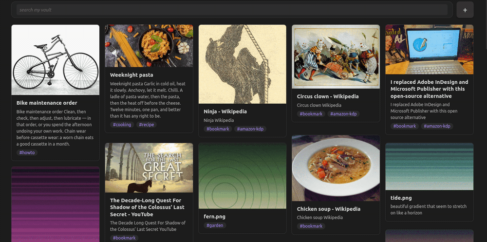

# Skybox

An Obsidian plugin that opens the vault as a wall of cards you can search, on desktop and Android.

It takes its shape from [mymind](https://mymind.com): everything you keep in one visual place, found
by typing rather than filed by hand. Obsidian holds the notes and the images; Skybox is the other
way of looking at them.




- **One pane over the whole vault.** Notes and images, most recently modified first. Typing makes
  chips, chips narrow the search, `#word` matches tags alone.
- **Make, change and throw away from the grid.** New notes open into Obsidian's own editor, live
  preview and all. Right-click a card, or long-press on a phone, to copy or delete it.
- **A note names itself** from its first line, once the typing settles. Rename it yourself and it is
  yours.
- **Drop things in,** from the desktop or straight out of a browser window. Anything already in the
  vault asks before it writes a second copy.
- **Bookmarks arrive on their own,** with no browser extension: point it at your browser's bookmarks
  file and keep bookmarking as you do. Each page is read once for its description, its picture and
  the article itself, so a bookmark is searchable by what the page said. Importing happens on
  desktop, where the browser's file is; on a phone the notes simply arrive with the rest of the
  vault.
- **Images are notes too,** each with a sidecar beside it holding its tags and thoughts. An image a
  note embeds belongs to that note, and stays out of the way.
- **Notes show what they hold.** A note that embeds an image puts the first one on its card, and the
  right pane lets you pick another. A note with no picture draws one, a gradient of its own.
- **Share a card by tagging it.** Connect a Mastodon account and a tag posts the card, image and
  all. The thread comes back beside the note, with a box to reply from. Untag it and the post goes.
- **Immersive.** Standalone mode gives the whole window to the pane, and the window controls hide
  until the pointer reaches the top.

## Installing

Skybox is not in Obsidian's community plugins yet, so it installs by hand. Either way you need the
three files a build leaves: **`main.js`**, **`manifest.json`** and **`styles.css`**, from the
[latest release](https://github.com/luanarium/skybox/releases) or from `npm install && npm run
build` in a clone.

### Straight into the vault folder

Put the three files in a folder called `skybox` inside your vault's `.obsidian/plugins/`. The
`.obsidian` folder is hidden, so turn on hidden files in your file manager first.

| | Where that is |
|---|---|
| Linux | `/home/<you>/<vault>/.obsidian/plugins/skybox/` |
| Windows | `C:\Users\<you>\<vault>\.obsidian\plugins\skybox\` |
| Android | `/sdcard/<vault>/.obsidian/plugins/skybox/`, or `Internal storage/<vault>/…` as most file managers show it |

Create `plugins` or `skybox` if they are not there. Then in Obsidian: **Settings → Community
plugins**, turn **Restricted mode** off, and switch **Skybox** on under *Installed plugins*. If
Obsidian was already running, reload it first (Ctrl+R) or it will not see the new folder.

### Through Obsidian

Open **Settings → Community plugins → Installed plugins**. Everything already in
`.obsidian/plugins/` is listed there, so this is where you enable Skybox after copying the files,
turn it off again, or reach its own settings through the gear beside it. There is no browse-and-
install route yet; that comes with the community list.

### With BRAT, which also keeps it updated

[BRAT](https://github.com/TfTHacker/obsidian42-brat) installs plugins straight from GitHub, which is
the easiest route on a phone and the only one that updates itself.

1. Install **BRAT** from Community plugins → Browse, and enable it.
2. **Settings → BRAT → Add beta plugin**.
3. Paste `luanarium/skybox` and confirm.

BRAT fetches the three files from the latest release and enables the plugin. It checks for new
releases on startup, so a new version arrives on its own.

## Layout of the source

| File | What lives there |
|---|---|
| `src/main.ts` | The plugin: settings, view registration, vault events, standalone mode |
| `src/view.tsx` | The `ItemView` that mounts React |
| `src/App.tsx` | The pane: chips, results, paging, intake, overlays |
| `src/index.ts` | The in-memory index of notes and images, kept current by vault events |
| `src/search.ts` | Chips, `prepareSimpleSearch` matching, excerpts |
| `src/compact.ts` | The shortest-column compactor and the card geometry |
| `src/cover.ts` | Which cover a note gets drawn, from its path |
| `src/preview.ts` | Which picture a card shows, and the `cover` property |
| `src/mastodon.ts` | The Mastodon client, and what can be worked out without one |
| `src/sharing.ts` | Posting a card when it is tagged, and deleting when it is not |
| `src/interactions.ts` | What has happened to a shared card, and what is unread |
| `src/components/Conversation.tsx` | The thread beside a shared card, and replying to it |
| `src/autoname.ts` | Naming a new note after its first line |
| `src/ignore.ts` | Folders the index leaves alone |
| `src/bookmarks.ts` | Reading the browser's bookmarks file into notes |
| `src/metadata.ts` | What a page declares about itself, read out of its HTML |
| `src/article.ts` | The page's own text, read with Defuddle |
| `src/ingest.ts` | The one intake path: hash, dedupe, write |
| `src/share.ts` | Mobile share intake and the bring-back |
| `src/sidecar.ts` | `<name>.<ext>.md` beside an image: its tags and thoughts |
| `src/writes.ts` | The flag that tells the plugin's own writes from a shared file |
| `src/components/` | Search box, card, masonry, note overlay, lightbox, metadata box, editor |
| `tests/` | What can be checked without a workspace, run with `npm test` |
| `src/confirm.ts` | The yes-or-no modal duplicates are asked about |
| `src/borrowed.ts` | The flag that says the overlay has one of Obsidian's leaves on loan |
| `src/window.ts` | Toggling maximize, the one call that leaves Obsidian's API behind |

## Dev loop

```sh
npm install
npm run dev                                            # esbuild watch
ln -s "$PWD" "<vault>/.obsidian/plugins/skybox"        # symlink into a dev vault
touch .hotreload                                       # Hot Reload reloads on rebuild
```

`npm run build` typechecks and writes a minified `main.js`. `app.emulateMobile(true)` in the
developer console previews the mobile layout.

`npm test` runs `tests/`: esbuild bundles each `*.test.ts` with the `obsidian` import pointed at
`tests/obsidian-stub.ts`, node runs it, and a file that throws fails. Obsidian cannot be driven from
a shell, so these cover the modules that need no workspace: the compactor and card geometry, the
sidecar and frontmatter rules, chips and search, and `ingest`'s duplicate branches against a fake
vault. Everything about views, transitions and window chrome still has to be looked at in the app.

## Browser bookmarks

Skybox imports bookmarks on its own, without a browser extension. Chromium browsers keep their
bookmarks in one JSON file and rewrite it whenever one changes, so `src/bookmarks.ts` reads that
file and writes a note for every bookmark the vault has not got yet:
the URL and the date in frontmatter, the browser's folder names as tags. It looks on load, when the
window comes back to the front, and every five minutes, and an unchanged file costs one `stat`.
Deduplication is by the `url` in frontmatter, read through the metadata cache, so a note moved or
renamed still counts as imported and nothing arrives twice.

### The shape of a bookmark note

The properties are the ones Obsidian's own Web Clipper writes, which its default template fixes as
`title`, `source`, `author`, `published`, `created`, `description` and `tags`. A bookmark gets
`title`, `source` (the URL), `created` (when the browser says you bookmarked it) and `tags`; the
other three wait until there is something to put in them. Every note also carries a `bookmark` tag,
playing the part `clippings` plays for the clipper: one handle for everything that came in this way.

Matching that shape is most of what makes these notes useful to anything else. A Dataview query
written for clipped pages works on them unchanged, an auto-tagger sees the same properties it
already knows, a template can fill them, and a person reading the properties panel sees what they
expect. It also means Skybox will not import a page you have already clipped, since deduplication
reads `source` across the whole vault, whoever wrote it. Notes from earlier imports used a `url`
key, which still counts as imported, so nothing arrives twice.

**Supported browsers** are the Chromium family, which is most of them: Brave, Chrome, Edge,
Vivaldi, Chromium itself, and anything else built on it, whether installed natively, as a Flatpak or
as a Snap. The settings look in the usual places for all of those and offer what they find, and any
path can be typed in by hand. Firefox keeps its bookmarks in `places.sqlite` rather than JSON, so it
is not supported yet and is on the list below.

**What arrives** is a title, a link, a date, the folders it came from, what the page says about
itself, and the page's own text. Which is to say: the thing you would otherwise have opened a
clipper for, without having opened anything.

### Asking a page about itself

Pages declare a summary for the social cards other sites show them in: a title, a description, an
image, often an author and a date. Each newly bookmarked page is asked once, and what it declared
fills the `description`, `author`, `published` and `image` properties the clipper's shape leaves
room for. The card then shows the page's own picture instead of cover art, and the description lands
in the note body, where a card's excerpt comes from, so a bookmark reads as more than its own URL.

This is part of importing a bookmark rather than a thing to switch on separately, because a link
with nothing to read is not worth keeping twice over. **Preview images** in the settings turns the
pictures off for anyone who would rather have cover art, and what each page said is still kept in
the note's properties.

`src/metadata.ts` does the reading, as string work rather than `DOMParser`, which keeps it testable
without a browser and stops half-broken HTML costing everything else in the head. Open Graph is
preferred over the older plain `name=` tags, relative image URLs are made absolute, entities are
decoded, and a date is kept only when one can actually be read out of what the page said.

This is the only part of Skybox that goes out to the network, and it only runs for a vault that has
set the import up. Eight pages per look, each asked once: a `fetched` date goes into the note
whether or not the page answered, so nothing is asked twice, and a long-kept bookmarks file fills in
over several passes rather than fetching hundreds of pages at once. Notes that came from somewhere
else are left alone, since the pass only touches notes carrying the `bookmark` tag or sitting in the
bookmarks folder.

Worth knowing: a preview image is shown from wherever the page keeps it, so displaying those cards
reaches those hosts. **Preview images** off stops that, and the cards draw cover art instead.

Why the file rather than something tidier: Brave's own sync is end-to-end encrypted between Brave
installs with nothing for a third party to hook, and `chrome.bookmarks` belongs to extensions, which
would need somewhere to send what they read. The file is the only route with no server and no
extension in it.

That means Node's `fs` and a path outside the vault, which is the second place this plugin steps
outside Obsidian's API and the browser, and a larger step than the first. So it is off until it is
switched on, the path is shown in the settings and editable rather than discovered silently, nothing
is read but that one file, and the whole thing is desktop only: on a phone the import does not
exist. The parsing is pure and tested headlessly in `tests/bookmarks.test.ts`, including the
microseconds-since-1601 timestamps Chromium writes.

It is one way and additive. A bookmark deleted in the browser leaves its note alone, because the
vault is where curating happens.

Left unconfigured, it does nothing at all. The switch is off, no path is set, no file is read and no
note is written, so a vault that never visits these settings carries on bookmarking exactly as it
did. What a bookmark note holds is a title, a link, a date and the folders it came from. If you want
the page's text, author and description today rather than when the list above gets built, Obsidian's
own [Web Clipper](https://obsidian.md/clipper) does that, and since these notes carry its
properties, the two sit side by side: neither imports a page the other has already saved.

### The page itself

**Keep the page's text** reads the article out of each bookmarked page and writes it into the note,
under a `## Page text` heading at the end, so a bookmark is searchable by what the page said and
survives the page going away. Anything written above that heading stays first and stays yours, and a
note that already holds the text is left alone, since the copy in the vault may have been edited and
the page may have moved on.

The reading is done by [Defuddle](https://github.com/kepano/defuddle), the library Obsidian's own
Web Clipper uses, so a bookmark gets the same reading a clip would have had. Extraction is the hard
part of saving a web page, telling the article from the newsletter box and the cookie notice, and
doing it badly is worse than not doing it at all.

That is the one dependency this project has taken on beyond React, and it is the full build of it,
because the slim entry point carries no Markdown converter and quietly returns HTML instead. The
plugin is about 1 MB because of that, the same ballpark as Tasks and well under Dataview. It is
pinned to an exact version, reached from `src/article.ts` alone, loaded on first use rather than at
startup, and never reached on a phone, where the fetch that feeds it does not run.

A card never shows the article. The excerpt stops at the `## Page text` heading and reads what the
note says above it, which is the page's own description; the text below is for searching.

### Where this is going

A bookmark now carries what its page says about itself and the page's own text. What is left, in
rough order of how much it would change things, none of it built yet:

1. **Favicons.** For the pages that declare no preview image, so every card has something.
2. **Firefox.** Its bookmarks live in `places.sqlite`, which needs a SQLite reader rather than a
   JSON parse, so the Chromium family came first. An export file is the easy half of this.
3. **More than one source at a time.** Several profiles, or several browsers, instead of the single
   path the settings take now.
4. **Noticing deletions.** Not acting on them, but saying so: a note for a bookmark that is no
   longer in the browser could say as much, and leave what to do about it to you.

On a phone none of this applies, since there is no file to read. Bookmarks arrive there the way
everything else does, by syncing the vault.

## Images a note embeds

Drop an image into a note and Obsidian writes it into the vault, so the grid has every right to show
it a card, but an image embedded in a note is part of that note's page rather than something kept
for its own sake. `metadataCache` already knows which is which: every note's `embeds` are resolved
on build, and an image some note embeds is marked `embedded` and given a tag nothing wrote,
`#embedded`.

What that buys is one rule rather than two settings: embedded images stay out of the everything
view, and nothing else changes. Any search still reaches them, `#embedded` asks for exactly those,
and the moment the last note stops embedding an image the mark falls away; there is nothing stored
to go stale, in the vault or anywhere else. **Images embedded in notes** in the settings turns the
rule off.

## Ignored folders

The grid shows every note and every image in the vault, which is the point: a picture is something
you kept, not an attachment belonging to a note. But a vault holds things that are not cards: an
attachment folder of images that live inside notes, a templates folder, or another vault nested
inside this one, whose every note would otherwise appear twice.

**Ignored folders** in the settings takes one folder per line, and the index skips everything under
them: notes, images and sidecars alike, since that is what ignoring a folder reads as. Matching is
case-insensitive and by whole path segment, so `attachments` leaves `attachments-2026` alone.
`src/ignore.ts` holds both halves and `tests/ignore.test.ts` covers them; the index re-reads the
list whenever it is rebuilt, which the settings do on every change.

## Naming a new note

A note from the plus button starts as `Untitled`, which says nothing on a card. `src/autoname.ts`
watches it: a second and a half after the typing stops, the note's first line becomes its name, with
heading marks and list bullets stripped, characters a filename cannot hold turned into spaces,
frontmatter and horizontal rules skipped, sixty characters at most. The rename goes through
`fileManager.renameFile`, so anything already linking to the note follows it.

Two rules keep it out of the way. Only a note still called `Untitled` (or `Untitled 4`) is renamed,
so a note you named yourself keeps its name however its first line reads; and once it has a name,
rewriting the first line is editing, not naming. **Name notes from their first line** in the
settings turns it off.

## Sharing to Mastodon

Tag a card with the sharing tag and it is posted: the note's title and words, the page's link where
it is a bookmark, and the picture attached where it is an image. Take the tag away and the post is
deleted. Both ask first, and the delete says what is about to be lost, counting the replies and
reactions the post has collected, because a thread other people took part in is not the same as a
post nobody saw.

The post's id and address are written into the note's frontmatter as `mastodon_id` and
`mastodon_url`, which is what ties the two together through a rename.

### What is waiting: `#comments`

A card with replies, favourites or boosts you have not seen wears a `#comments` tag, so typing that
in the search box brings up everything waiting on you, the way any other chip does. Nothing writes
the tag. It is derived, the same way `#embedded` is, and for a better reason: reading is something a
person does on a device, and a tag written into a note would churn the file and tell your other
devices you had read something they never showed you.

One request covers every shared card, since `/api/v1/notifications` returns replies, favourites and
boosts together. It is made when the plugin loads, when the window comes forward, and every four
minutes a window is left open. A favourite or a boost names the card's own post; a reply names
itself, so an unfamiliar one costs a second request to find which card it sits under, and the answer
is remembered. What is unread, and how far the last look got, live in the vault's local storage
beside the token, so none of it syncs or reaches the vault.

Opening a card's conversation is what marks it read, and the tag falls away.

The plus button does double duty rather than the grid growing a bell. While something is waiting it
wears the accent colour instead of its usual orange, and a press puts the `#comments` chip in the
search box, which is what the button is for in that moment; pressing it settles the colour until
something new arrives. A right click, or a long press on a phone, opens the usual menu whatever the
colour, so making a note never becomes unreachable.

### The conversation, beside the note

A shared card's right pane gains a second tab, and a card that has been posted opens on it, because
the properties are in the note and have not moved while the thread is somewhere else and may have.
**Properties** is everything a card has always shown; **Conversation** is the thread: who replied,
what they said, how many favourites and boosts it collected, a link to the post, and a box at the
foot of the column to reply from.

A Mastodon thread is a tree, since every status says what it answers, so each reply carries its own
reply button and the thread nests under the one being answered. Answering someone starts the box
with their handle, the way every Mastodon client does, because a reply nests either way but the
person is only told about it if they are mentioned in it. Replying with nobody chosen answers the
post itself. Either way it posts as the connected account at the visibility in the settings, and the
thread is read again straight afterwards so your reply sits where everyone else will see it.

Nothing is written into the vault. A conversation belongs to the server it happened on, and a copy
in the note would be stale the moment somebody else replied, so the tab reads the instance each time
it is opened and there is a refresh beside the counts. Reply text arrives as the server's HTML and
is turned into words before it reaches the page, never injected as markup.

Two things are deliberately careful. A note that already carries the tag when Obsidian starts is
remembered rather than posted, since turning this on should not publish a vault; only a tag added
while the plugin is running means anything. And the token is not kept with the settings. It goes to
Obsidian's per-vault local storage, which does not sync and is not part of the vault, so it stays on
the computer it was pasted into rather than travelling to your phone or sitting among your notes.
Revoking is done on the instance, as it should be.

This is the one external service the plugin talks to. `src/mastodon.ts` is the client, written
against the API rather than a library: `requestUrl` is Obsidian's own fetch and sidesteps CORS, and
the pieces that can be worked out without a server, composing a post inside the instance's character
limit and building the multipart body an upload wants, are pure functions with tests.

## What a card shows

A note that embeds an image has a picture already, and the first one is almost always what the note
is about, so it becomes the card and the drawn gradient steps aside. A note that would rather show a
different one says so in a `cover` property, which the right pane writes when you pick from the
images the note holds: it offers every embedded image and the drawn cover as the last choice, so
going back to the gradient is the same gesture as picking a picture.

The order a card follows is the cover you chose, then a picture fetched for a bookmark, then the
first thing the note embeds, then the drawn one. `src/preview.ts` holds the reading of a `cover`
value, which may be `[[a.png]]`, `![[a.png]]`, `[[a.png|alias]]` or a bare path.

## Cover art

A note has no picture of its own, so the grid draws one. `src/cover.ts` hashes the note's path and
reads a palette and a shape out of it (eight palettes, four shapes, all in `styles.css` as CSS
gradients), and then nudges both: the hue turned a few degrees, the light lifted or dropped, the
shape moved along the horizon, spaced, tilted and scaled. Those nudges ride down as custom
properties and every gradient reads them with a fallback, so the bounds live in one place and a
cover still draws without them. Thirty-two looks become a fingerprint: the demo vault's 24 notes
share 17 palette-and-shape combinations but no two covers alike.

The hash is FNV-1a with murmur3's finalizer over the top. Without that last step its low bits are
not independent (a multiply's low bits come only from its inputs' low bits), and every note's
shape came out as its palette plus two. `tests/cover.test.ts` is what caught it.

The same note is drawn the same way on every machine and every rebuild, nothing is written into the
vault, and a theme or a snippet can restyle or hide the lot. **Cover art** in the settings turns it
off for anyone who wants the words alone. The overlays are plain black and white at low opacity
rather than mixes of the palette, which keeps them working on an older Android WebView.

## The expanded note

Clicking a note card borrows Obsidian's own markdown editor: a real markdown leaf is created out of
sight in the right sidebar, and its view is moved into the overlay. That brings live preview with
it, so headings, links, embeds and images render as they are typed, and the view saves the file
itself.
The borrowed leaf is detached when the overlay closes, and the empty husk it leaves behind is hidden
by a stylesheet rule. If a leaf cannot be borrowed, the overlay falls back to a plain CodeMirror
editor over the file's text, writing through `vault.process`.

The cursor stays out of the note until it is clicked, so the first line opens as a rendered heading
rather than as `# title` under a caret. **Focus the editor on open** in the settings puts the cursor
there straight away instead. Closing blurs the editor before the transition starts, so the text the
card shrinks into is the rendered text.

While a leaf is on loan it counts as Obsidian's active leaf, so the plugin treats a borrowed editor
as the grid rather than as somewhere else, and closing the overlay hands the active leaf back.

"Open in Obsidian" puts the note in its own tab and adds a **Back to Skybox** action to that tab's
header. It is desktop only: a phone has no tabs to open into, so the note would take the grid's own
leaf and leave the sheet sitting over nothing. In standalone mode, where the ribbon and tab bar are
hidden, a pill in the bottom-left corner appears whenever the grid is up but something else is in
front of it. Both ways back reveal
the grid *and* make it the active pane; revealing alone leaves the pill hanging around until
something is clicked.

## The head, the composer and the places

The search box and the plus button hold the top of the pane while the grid scrolls under them, on
both platforms; in a standalone window the drag band rides along with them, so the window can still
be moved once the grid has been scrolled.

The plus button is square, beside the search box, and offers the two ways in: **New note**, which
writes a note into the intake folder and expands it straight into its editor, and **Add files**,
which opens the file picker. Files also arrive by drag and drop or from the share sheet, and a card
for a file that has just arrived drops into the grid.

A drop that lands on an open card belongs to Obsidian's editor, not to intake: it writes the file to
the attachment folder and embeds it where the cursor is. Taking it in as well would import the same
image twice, once embedded and once as a card of its own, and the content hash cannot catch it,
because Obsidian's copy has no sidecar to carry one.

A long press on a card, or a right click, offers **Copy** and **Delete**. Copy takes a note's text,
or the image itself where the clipboard will have it and its path where it will not. Delete asks
first and goes through `trashFile`, so it honours the vault's own deleted-files setting, and it
takes an image's sidecar with it.

A phone also carries a round toggle above those places for standalone mode, which otherwise hides
the navbar and puts Obsidian's own settings a long way off. It is there for trying the mode out, and
nothing but mobile shows it.

Along the bottom of a phone sit three places (everything, spaces, serendipity) as placeholders.
They are deliberately not wired up to anything yet.

## On a phone

Fewer columns, from the container width: a narrow screen may pack cards into 160px columns rather
than 240px, so a phone gets a two-column grid in portrait instead of one card per screen. **Columns
on a phone** in the settings pins it to one or two instead.

The search box does not take the cursor on a phone, because the keyboard would come up over a grid
the reader opened to scroll. Obsidian's own sheet animation is the only movement on mobile: the
card transitions and the staggered fade sit out, except the drop-in the composer earns.

The expanded card is hosted in one of Obsidian's own modals, rendered into it through a portal. A
modal is a history handler, so the Android back gesture closes the card instead of leaving the app,
a tap outside closes it, and it arrives as a full-screen sheet with Obsidian's own animation, which
is why the shared-element view transition sits out on mobile. The header carries a back arrow where
an Android reader looks for one, and the × steps aside. Down the sheet it is plain block flow (the
editor or the image, then the side pane below it), so nothing is asked to shrink and the whole sheet
scrolls.

## Getting a build onto a phone

Installing is covered at the top; this is the development side of it, where there is no release to
install from yet.

```sh
npm run deploy                              # builds, then copies into ./dist/skybox
SKYBOX_DEST=~/Music/skybox-dist npm run deploy
```

That leaves a plain `skybox` folder to drag across over FTP or a cable, into
`<vault>/.obsidian/plugins/` on the device. A folder rather than an archive, because unpacking one
on a phone is the tedious part.
Obsidian Sync with installed plugins turned on, or a tagged release through BRAT, saves doing it by
hand at all.

Content hashing needs `crypto.subtle` and so a secure context. Obsidian's own windows are one, but
where it is missing the intake says so once and takes the file in without a hash rather than
swallowing it: dedupe is what degrades, not the import.

## Tags

The tag box writes to frontmatter, so Obsidian's own tag pane sees everything added here. A tag
appears the moment it is typed and is reconciled against the index afterwards, because the write
only comes back through the metadata cache, and a note open in an editor can take a couple of
seconds to get there. A write that fails rolls the tag back and says so. The × is only on tags that
live in frontmatter: a `#tag` written in the body belongs to the body. Suggestions come from the
index, so they are the tags already in the vault.

The index is taken again when `metadataCache` fires `resolved`: before that, tags and headings read
as empty for files the cache has not reached yet.

## Standalone chrome

Standalone mode hides the ribbon, tab bar, sidebars and status bar with a stylesheet, and on Android
the navbar too. The titlebar's back and forward arrows are hidden as well, since the grid keeps no
navigation history for them to walk. The window buttons fade out and come back when the pointer
reaches the top edge of the window, a band as tall as `--titlebar-height`.

In a frameless window Obsidian's draggable region is the tab header bar, so hiding it leaves the
window with nothing to drag by. The top band of the window takes that job: a mouse-down there moves
the window, a double-click maximizes it, and the window buttons fade in and out of it. The listeners
are on the document and keyed on the pointer's distance from the top edge, so whatever happens to be
in that band answers (the pane's own drag band, a view header, the titlebar overlay), and anything
in it that is there to be clicked is left alone. The grid's view header is hidden in standalone
along with the titlebar arrows and the sidebar toggles: no history to walk, no sidebar to toggle. A
note opened in Obsidian keeps its header, which is where the way back lives.

In the middle of that band sits the way to the settings, arriving and leaving with the window
buttons, because standalone mode hides every other route to them. The settings window is not part of
the public API, so if `app.setting` is ever not there the button says where to look instead of
failing quietly.

**Appearance** in the settings dresses the pane light or dark on its own. `.theme-dark` and
`.theme-light` go on the pane and on the sheets, which are Obsidian's own modals and live outside
it, and that gives those subtrees the other palette, but it changes nothing visible on its own. The
palette is the `--color-base-*` ramp; the names everything is drawn with (`--background-primary` and
the rest) are declared on `body` in terms of the ramp, so they are resolved there and reach the pane
already decided.

So `src/theme.ts` declares those names again, for the pane alone. Rather than pin a copy of
Obsidian's mappings into the stylesheet, it reads them back out of the live stylesheets: whatever
this Obsidian and this theme declare on `body`, and whatever leans on the ramp however many names
deep, is re-declared in a scoped `<style>` and recomputed from the ramp the pane now has. It is
rebuilt when Obsidian fires `css-change`, and a handful of core names are also written plainly in
`styles.css` so the pane's own furniture flips even if that walk comes back empty.

Moving and maximizing go through Electron's window, the way Obsidian's own titlebar buttons do, in
`src/window.ts`, the single place the plugin steps outside Obsidian's API and the browser. It is
desktop-only and feature-detected, the settings tab says whether this window handed a handle over,
and without one the band falls back to a CSS `app-region: drag` region. Android never touches it.

## Two notes on the implementation

- **A known hash asks before it writes.** Drop or pick a file whose contents are already in the
  vault and Skybox asks: add it again, or open the one you have. Dismissing the question opens the
  existing card and writes nothing. Shared items are the same question from the other side: the
  share target has already written the copy, so the choice is to keep it or move it to the trash,
  and dismissing the question keeps it. A hash held by several cards resolves to the newest.
- **`@codemirror/commands` is declared, not installed.** Obsidian ships the CodeMirror 6 modules and
  hands them to plugins at runtime, so they are external to the bundle. `@codemirror/state` and
  `@codemirror/view` come with types through the `obsidian` package; the few pieces of
  `@codemirror/commands` the editor uses are declared in `src/codemirror.d.ts` instead of adding a
  dependency.
